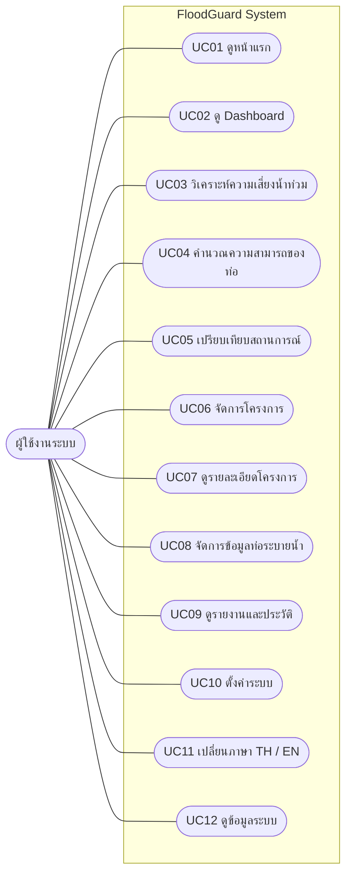

# FloodGuard — ระบบวิเคราะห์ความเสี่ยงน้ำท่วมและจัดการระบบระบายน้ำ

> เอกสารสรุปโครงงานสำหรับงานคู่ ครอบคลุมภาพรวมระบบ Use Case การแบ่งหน้าที่สมาชิก และแนวทางทดสอบ

## 1. ภาพรวมโครงงาน

**FloodGuard** เป็นเว็บแอปพลิเคชันสำหรับช่วยวิเคราะห์ปริมาณน้ำท่า ประเมินความสามารถในการระบายน้ำของท่อ เปรียบเทียบสถานการณ์ฝน และจัดการข้อมูลโครงการกับระบบระบายน้ำ

### วัตถุประสงค์
1. คำนวณปริมาณน้ำท่าจากข้อมูลพื้นที่และความเข้มฝน
2. ประเมินความสามารถในการระบายน้ำของท่อ
3. เปรียบเทียบผลลัพธ์เมื่อกำหนดความเข้มฝนหลายระดับ
4. จัดเก็บและเรียกดูข้อมูลโครงการ ข้อมูลท่อ และประวัติการวิเคราะห์
5. นำเสนอข้อมูลผ่าน Dashboard รายงาน และหน้าจอที่เข้าใจง่าย
6. รองรับการเปลี่ยนภาษาไทย (TH) และอังกฤษ (EN) หากมีการติดตั้งฟังก์ชันนี้ในเวอร์ชันที่ส่งมอบ

> **ข้อควรทราบ:** ผลการคำนวณเป็นข้อมูลช่วยประเมินเบื้องต้น ไม่ใช่การรับรองความปลอดภัยหรือการออกแบบทางวิศวกรรมขั้นสุดท้าย ต้องตรวจสอบข้อมูลนำเข้า สมมติฐาน และมาตรฐานที่เกี่ยวข้องก่อนนำไปใช้จริง

## 2. ผู้ใช้งานระบบ (Actor)

### ผู้ใช้งานระบบ (User)
ผู้ที่เข้ามาดูข้อมูล วิเคราะห์สถานการณ์ และจัดการข้อมูลที่ระบบเปิดให้ใช้งาน เช่น นักศึกษา ผู้ศึกษาเรื่องน้ำท่วม เจ้าหน้าที่ หรือผู้ปฏิบัติงานด้านระบบระบายน้ำ

ใน Use Case Diagram เบื้องต้นสามารถใช้ Actor หลักเพียงหนึ่งตัวได้ หากระบบจริงยังไม่มีการแบ่งสิทธิ์ตามบทบาท เช่น ผู้ดูแลระบบหรือผู้ใช้งานทั่วไป

## 3. รายการ Use Case

| รหัส | Use Case | คำอธิบาย |
|---|---|---|
| UC01 | ดูหน้าแรก | ดูข้อมูลแนะนำและวัตถุประสงค์ของ FloodGuard |
| UC02 | ดู Dashboard | ดูสถิติและภาพรวมข้อมูลที่ระบบมี |
| UC03 | วิเคราะห์ความเสี่ยงน้ำท่วม | ป้อนข้อมูลพื้นที่และฝนเพื่อคำนวณปริมาณน้ำท่าและประเมินผล |
| UC04 | คำนวณความสามารถของท่อ | ใช้สมการ Manning เพื่อประเมินความสามารถในการระบายน้ำของท่อ |
| UC05 | เปรียบเทียบสถานการณ์ | ป้อนความเข้มฝนหลายค่าเพื่อเปรียบเทียบผลคำนวณ |
| UC06 | จัดการโครงการ | เพิ่ม ดู แก้ไข และลบข้อมูลโครงการ ตามฟังก์ชันที่ระบบรองรับ |
| UC07 | ดูรายละเอียดโครงการ | ดูรายละเอียดและผลวิเคราะห์ที่เชื่อมโยงกับโครงการ |
| UC08 | จัดการข้อมูลท่อระบายน้ำ | เพิ่ม ดู แก้ไข และลบข้อมูลท่อหรือสินทรัพย์ระบายน้ำ |
| UC09 | ดูรายงานและประวัติ | เรียกดูผลวิเคราะห์หรือประวัติที่ระบบบันทึกไว้ |
| UC10 | ตั้งค่าระบบ | ดูหรือปรับการตั้งค่าที่มีอยู่จริงในเวอร์ชันที่ส่งมอบ |
| UC11 | เปลี่ยนภาษา | สลับภาษาไทยและภาษาอังกฤษ หากเปิดใช้งานแล้ว |
| UC12 | ดูข้อมูลระบบ | ดูคำอธิบายและข้อมูลเกี่ยวกับ FloodGuard |

**หมายเหตุ:** ตรวจสอบรายการนี้เทียบกับโค้ดจริงก่อนส่งรายงาน หากฟังก์ชันใดยังไม่ได้พัฒนาหรือใช้งานไม่ได้ ให้ระบุเป็นงานในอนาคต ไม่ควรนำเสนอว่าเสร็จสมบูรณ์แล้ว

## 4. Use Case Diagram

เส้นเชื่อมแสดงว่าผู้ใช้งานสามารถเรียกใช้ Use Case นั้นได้ กรอบ FloodGuard System แสดงขอบเขตของระบบ

## 5. รายละเอียด Use Case สำคัญ

### UC03 — วิเคราะห์ความเสี่ยงน้ำท่วม
- **Actor:** ผู้ใช้งานระบบ
- **ข้อมูลนำเข้า:** พื้นที่รับน้ำ ค่าสัดส่วนน้ำฝนที่ไหลบ่าบนพื้นผิว และความเข้มฝน
- **ขั้นตอนหลัก:**
  1. ผู้ใช้เปิดหน้าวิเคราะห์
  2. กรอกข้อมูลที่จำเป็นและตรวจสอบหน่วย
  3. ระบบตรวจสอบความถูกต้องของข้อมูล
  4. ระบบคำนวณปริมาณน้ำท่า
  5. ระบบแสดงผลและระดับการประเมินตามเกณฑ์ที่กำหนด
- **ผลลัพธ์:** ค่าที่คำนวณได้และข้อมูลประกอบการประเมิน
- **กรณีผิดพลาด:** หากข้อมูลไม่ครบหรืออยู่นอกช่วงที่ยอมรับ ระบบแจ้งข้อผิดพลาดให้แก้ไข

### UC04 — คำนวณความสามารถของท่อ
- **Actor:** ผู้ใช้งานระบบ
- **ข้อมูลนำเข้า:** เส้นผ่านศูนย์กลางท่อ ความลาดเอียง และค่าความฝืดของผิวท่อ
- **ขั้นตอนหลัก:**
  1. ผู้ใช้กรอกข้อมูลท่อ
  2. ระบบตรวจสอบค่าที่กรอก
  3. ระบบใช้สมการ Manning คำนวณความสามารถในการระบายน้ำ
  4. ระบบนำผลไปเปรียบเทียบกับปริมาณน้ำที่คาดว่าจะไหลเข้า
  5. ระบบแสดงผลการประเมิน
- **ผลลัพธ์:** ความสามารถในการระบายน้ำและอัตราการใช้งานเทียบกับความสามารถของท่อ
- **กรณีผิดพลาด:** แจ้งเมื่อข้อมูลไม่ถูกต้อง เช่น เส้นผ่านศูนย์กลางหรือความลาดเอียงไม่เป็นค่าบวก

### UC05 — เปรียบเทียบสถานการณ์
- **Actor:** ผู้ใช้งานระบบ
- **ข้อมูลนำเข้า:** ข้อมูลพื้นที่และท่อ พร้อมค่าความเข้มฝนหลายระดับ
- **ขั้นตอนหลัก:**
  1. ผู้ใช้ระบุค่าความเข้มฝนที่ต้องการทดสอบ
  2. ระบบตรวจสอบรูปแบบและจำนวนค่าที่กรอก
  3. ระบบคำนวณแต่ละสถานการณ์ด้วยข้อมูลชุดเดียวกัน
  4. ระบบแสดงผลเปรียบเทียบปริมาณน้ำและความสามารถของท่อ
  5. ผู้ใช้เปรียบเทียบความแตกต่างระหว่างสถานการณ์
- **ผลลัพธ์:** ตารางหรือองค์ประกอบแสดงผลเปรียบเทียบ
- **กรณีผิดพลาด:** แจ้งเมื่อค่าฝนไม่ใช่ตัวเลข หรือจำนวนสถานการณ์เกินขอบเขตที่ระบบกำหนด

### UC06 — จัดการโครงการ
- **Actor:** ผู้ใช้งานที่ได้รับอนุญาตตามระบบจริง
- **ขั้นตอนหลัก:** เปิดหน้ารายการโครงการ เลือกเพิ่ม ดู แก้ไข หรือลบ แล้วระบบตรวจสอบและบันทึกข้อมูล
- **ผลลัพธ์:** รายการโครงการที่อัปเดต
- **ข้อควรระวัง:** หากเวอร์ชันจริงไม่มีระบบยืนยันตัวตนหรือกำหนดสิทธิ์ ต้องอธิบายตามพฤติกรรมจริงของระบบ

### UC08 — จัดการข้อมูลท่อระบายน้ำ
- **Actor:** ผู้ใช้งานที่ได้รับอนุญาตตามระบบจริง
- **ขั้นตอนหลัก:** ดูรายการท่อ เพิ่มข้อมูลใหม่ แก้ไขรายละเอียด หรือลบข้อมูลที่ไม่ต้องการ
- **ผลลัพธ์:** ข้อมูลท่อที่จัดเก็บในฐานข้อมูล
- **ข้อควรระวัง:** ตรวจสอบว่าฟังก์ชัน CRUD ทั้งหมดทำงานจริงก่อนระบุในรายงาน

### UC09 — ดูรายงานและประวัติ
- **Actor:** ผู้ใช้งานระบบ
- **ขั้นตอนหลัก:** เปิดหน้ารายงาน เลือกดูข้อมูลที่บันทึกไว้ และตรวจสอบผลการวิเคราะห์ย้อนหลัง
- **ผลลัพธ์:** รายการผลวิเคราะห์หรือรายงานตามความสามารถของระบบ
- **หมายเหตุ:** การดาวน์โหลด PDF/Excel ให้ระบุเป็น Use Case เพิ่มเฉพาะเมื่อมีการพัฒนาฟังก์ชันดังกล่าวแล้ว

## 6. การแบ่งงานสำหรับสมาชิก 2 คน

### สมาชิกคนที่ 1 — ระบบคำนวณและวิเคราะห์ทางวิศวกรรม

**หน้าที่หลัก**
- พัฒนาและตรวจสอบ Rational Method สำหรับคำนวณปริมาณน้ำท่า
- พัฒนาและตรวจสอบ Manning's Equation สำหรับคำนวณความสามารถของท่อ
- พัฒนาการวิเคราะห์ความเสี่ยงตามเกณฑ์ของระบบ
- พัฒนาการเปรียบเทียบสถานการณ์ฝนหลายระดับ
- ดูแล Logic และ Service ที่เกี่ยวข้องกับการคำนวณ
- ตรวจสอบหน่วย สูตร เงื่อนไข และความสมเหตุสมผลของผลลัพธ์
- ร่วมเชื่อมผลการคำนวณเข้ากับหน้ารายงานและประวัติ

**Use Case ที่รับผิดชอบหลัก**
- UC03 วิเคราะห์ความเสี่ยงน้ำท่วม
- UC04 คำนวณความสามารถของท่อ
- UC05 เปรียบเทียบสถานการณ์
- ส่วน Logic ของ UC09 ที่เกี่ยวข้องกับผลวิเคราะห์

**ผลงานที่ส่งมอบ**
- โมดูลคำนวณ
- Service และ Validation ที่เกี่ยวข้อง
- หน้าวิเคราะห์/เปรียบเทียบในส่วนที่รับผิดชอบ
- กรณีทดสอบสูตรและผลลัพธ์

### สมาชิกคนที่ 2 — การจัดการข้อมูลและส่วนติดต่อผู้ใช้

**หน้าที่หลัก**
- พัฒนา Home และ Dashboard
- พัฒนาระบบจัดการโครงการและหน้ารายละเอียดโครงการ
- พัฒนาระบบจัดการข้อมูลท่อระบายน้ำ
- พัฒนาการแสดงรายงานและประวัติ
- พัฒนาระบบเปลี่ยนภาษาไทย/อังกฤษ หากอยู่ในขอบเขตเวอร์ชันนี้
- ดูแล CSS, Responsive Layout, Navbar, Forms, Tables และ Cards
- ปรับข้อความให้เข้าใจง่ายและสม่ำเสมอทั้งสองภาษา

**Use Case ที่รับผิดชอบหลัก**
- UC01 ดูหน้าแรก
- UC02 ดู Dashboard
- UC06 จัดการโครงการ
- UC07 ดูรายละเอียดโครงการในส่วนการแสดงข้อมูล
- UC08 จัดการข้อมูลท่อระบายน้ำ
- UC09 แสดงรายงานและประวัติ
- UC10 ตั้งค่าระบบ
- UC11 เปลี่ยนภาษา
- UC12 ดูข้อมูลระบบ

**ผลงานที่ส่งมอบ**
- หน้า Home และ Dashboard
- Forms และหน้าจัดการข้อมูล
- Templates และ CSS
- ระบบภาษาและข้อความ
- หน้ารายงานในส่วนการนำเสนอข้อมูล

### งานที่ทำร่วมกัน

| งาน | ความรับผิดชอบร่วม |
|---|---|
| วิเคราะห์ปัญหาและกำหนดวัตถุประสงค์ | ทั้งสองคน |
| กำหนด Actor และ Use Case | ทั้งสองคน |
| ออกแบบฐานข้อมูลและความสัมพันธ์ | ทั้งสองคน |
| กำหนดรูปแบบข้อมูลระหว่าง Route, Service และ Template | ทั้งสองคน |
| เชื่อมผลคำนวณเข้ากับระบบจัดการข้อมูล | ทั้งสองคน |
| ทดสอบระบบแบบรวม | ทั้งสองคน |
| ใช้ Git และแก้ปัญหาตอนรวมโค้ด | ทั้งสองคน |
| จัดทำรายงานและเตรียมนำเสนอ | ทั้งสองคน |

## 7. ตารางแบ่งงานแบบสรุป

| งาน | สมาชิกคนที่ 1 | สมาชิกคนที่ 2 |
|---|---|---|
| วิเคราะห์และออกแบบระบบ | ร่วม | ร่วม |
| Rational Method | หลัก | ทดสอบการแสดงผลร่วม |
| Manning's Equation | หลัก | ทดสอบการแสดงผลร่วม |
| วิเคราะห์/เปรียบเทียบสถานการณ์ | หลัก | UI และการแสดงผลร่วม |
| Home / Dashboard | สนับสนุนการตรวจข้อมูล | หลัก |
| จัดการโครงการ | เชื่อมผลวิเคราะห์ | หลัก |
| จัดการท่อระบายน้ำ | ตรวจค่าที่ใช้คำนวณ | หลัก |
| รายงานและประวัติ | Logic ผลวิเคราะห์ | UI และการดึงข้อมูล |
| ระบบภาษา | ตรวจข้อความผลคำนวณ | หลัก |
| CSS และ Responsive | ตรวจหน้าที่เกี่ยวข้อง | หลัก |
| ทดสอบและนำเสนอ | ร่วม | ร่วม |

การแบ่งนี้เป็นการแบ่งผู้รับผิดชอบหลัก ไม่ได้หมายความว่าอีกคนห้ามช่วยงานส่วนนั้น ทั้งคู่ควรเข้าใจภาพรวมของระบบและสามารถอธิบายการทำงานหลักได้

## 8. แผนการทำงาน

1. **วิเคราะห์และวางแผน:** สรุปปัญหา วัตถุประสงค์ ขอบเขต Actor และ Use Case
2. **ออกแบบ:** วางโครงสร้างฐานข้อมูล เส้นทางการทำงาน และรูปแบบหน้าจอ
3. **พัฒนาแยกส่วน:** สมาชิกคนที่ 1 ทำส่วนคำนวณ สมาชิกคนที่ 2 ทำส่วนจัดการข้อมูลและ UI
4. **เชื่อมระบบ:** ตกลงชื่อ Field และรูปแบบผลลัพธ์ระหว่าง Service, Route, Template และฐานข้อมูล
5. **ทดสอบ:** ทดสอบข้อมูลปกติ ข้อมูลผิดพลาด และค่าขอบเขต
6. **ปรับปรุง UI:** ตรวจทุกหน้าบน Desktop และ Mobile รวมถึงภาษา TH/EN หากรองรับ
7. **จัดทำเอกสาร:** เตรียม Use Case Diagram, ตารางแบ่งงาน ภาพหน้าจอ และสคริปต์นำเสนอ

## 9. แนวทางทดสอบระบบ

| กรณีทดสอบ | ผลที่คาดหวัง |
|---|---|
| กรอกข้อมูลวิเคราะห์ครบและถูกต้อง | ระบบคำนวณและแสดงผล |
| ไม่กรอกข้อมูลที่จำเป็น | ระบบแจ้งเตือนและไม่คำนวณด้วยข้อมูลที่ไม่ครบ |
| กรอกค่าติดลบในช่องที่ต้องเป็นค่าบวก | ระบบปฏิเสธข้อมูล |
| กรอกค่าสัดส่วนน้ำฝนนอกช่วงที่กำหนด | ระบบแจ้งข้อผิดพลาด |
| ทดสอบความเข้มฝนหลายค่า | ระบบแสดงผลเปรียบเทียบแต่ละสถานการณ์ |
| เพิ่มหรือแก้ไขโครงการ | ข้อมูลถูกบันทึกและแสดงตามที่ระบบรองรับ |
| เพิ่มหรือแก้ไขข้อมูลท่อ | ข้อมูลถูกบันทึกและแสดงตามที่ระบบรองรับ |
| เปิดประวัติการวิเคราะห์ | แสดงเฉพาะข้อมูลที่มีอยู่จริงในฐานข้อมูล |
| เปลี่ยน TH/EN | ข้อความที่รองรับเปลี่ยนภาษาตามที่เลือก |
| เปิดเว็บบนมือถือ | Layout ไม่ล้นหรือทับกัน |

ควรบันทึกผลทดสอบจริง พร้อมภาพหน้าจอหรือข้อมูลตัวอย่าง และไม่ระบุว่าผ่านหากยังไม่ได้ทดสอบ

## 10. คำศัพท์ที่ใช้ในระบบ

| คำศัพท์ | คำอธิบายที่เข้าใจง่าย |
|---|---|
| Runoff Coefficient | สัดส่วนน้ำฝนที่ไหลบนพื้นผิว |
| Catchment Area | ขนาดพื้นที่รับน้ำฝน |
| Rainfall Intensity | ปริมาณฝนที่ตกต่อชั่วโมง |
| Pipe Diameter | เส้นผ่านศูนย์กลางท่อ |
| Slope | ความลาดเอียงของท่อ |
| Roughness | ค่าความฝืดของผิวท่อ |
| Runoff | ปริมาณน้ำที่ไหลบ่าจากพื้นที่ |
| Pipe Capacity | ความสามารถในการระบายน้ำของท่อ |
| Utilization | ปริมาณน้ำเมื่อเทียบกับความสามารถของท่อ |
| Risk Level | ระดับความเสี่ยงตามเกณฑ์ที่ระบบกำหนด |

## 11. สรุปโครงงานสำหรับนำเสนอ

FloodGuard เป็นเว็บแอปพลิเคชันที่ช่วยคำนวณปริมาณน้ำท่า ประเมินความสามารถของท่อระบายน้ำ และเปรียบเทียบผลเมื่อกำหนดสถานการณ์ฝนต่างกัน พร้อมจัดการข้อมูลโครงการ ข้อมูลท่อ และประวัติการวิเคราะห์

โครงงานแบ่งความรับผิดชอบเป็นสองส่วนหลัก ได้แก่

- **สมาชิกคนที่ 1:** รับผิดชอบ Logic การคำนวณทางวิศวกรรมและการเปรียบเทียบสถานการณ์
- **สมาชิกคนที่ 2:** รับผิดชอบการจัดการข้อมูล ส่วนติดต่อผู้ใช้ การแสดงผล และระบบภาษา

ทั้งสองคนร่วมกันวิเคราะห์ ออกแบบฐานข้อมูล เชื่อมระบบ ทดสอบ และจัดทำเอกสาร เพื่อให้ระบบทำงานเป็นส่วนเดียวกัน

---

## หมายเหตุก่อนส่งรายงาน

เอกสารนี้เป็นแม่แบบสรุปขอบเขตและการแบ่งงาน ควรตรวจสอบกับโค้ดเวอร์ชันสุดท้ายอีกครั้ง โดยเฉพาะ CRUD, การตั้งค่า, ระบบภาษา และความสามารถในการส่งออกรายงาน เพื่อให้ Use Case ตรงกับฟังก์ชันที่พัฒนาจริง
